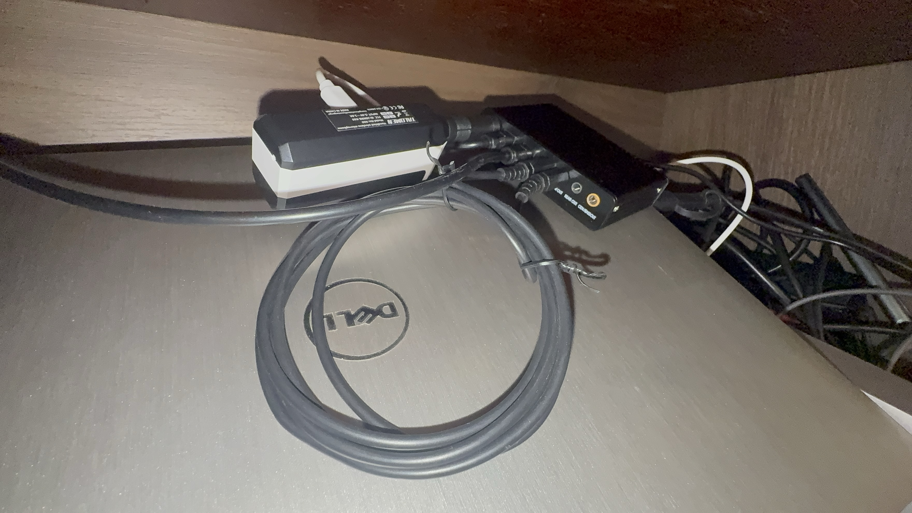

# CM6206 based USB 5.1 Audio Sound Card + Raspberry Pi Karaoke Mixer

This project outlines the process I went through (with assistance from Microsoft CoPilot) to develop a Karaoke Box using a cheap $30 [CM6206 TOSLINK/SPDIF Sound Card](https://www.amazon.com.au/Sound-Card-Channel-Output-Adapter/dp/B0CGX1WDFW) from Amazon and a Raspberry Pi to build a full Karaoke Mixer. This utilises modularised CM6206 audio routing and a Flask control panel.

## Hardware Prep
This build stems off a [CM6206 based SPDIF Sound Card](https://www.amazon.com.au/Sound-Card-Channel-Output-Adapter/dp/B0CGX1WDFW). This hardware is limited by only allowing a single input be selected (Line In, Mic In, or SPDIF In) in the Audio Interface at any given time. To get around this and mix together the SPDIF Input with the Microphone Signal, some HID trickery was used to take the SPDIF Stereo Input and route it across the 5.1 Out (SPDIF and Front/Rear/Center/Bass TRS) out, and to sum the Line In and Mic internally in the box. 

This allowed a TRS Cable to jump connect the Front Out to the Line In (carrying the SPDIF Stereo Audio). This mixed output (with levels controlled by the Raspberry PI via commands or the Flask Web UI) is then sent out the SPDIF Out which can go to a Soundbar or Speaker Set. 
The Microphone input is a 3.5MM Stereo jack, so I ended up using a 6.5MM to 3.5MM Adapter which was lying around. The microphone I have was very low gain, so by default the microphone volume is set to 100% - this may result in some lost eardrums or speaker grills if not careful (have the Flask UI Open to control volume for the Mic when first connecting and if possible mute the Microphone first).

## Hardware Warnings
Although these audio interfaces list 5.1 is supported, 5.1 Dolby/ACS Encrypted Audio will not work with this solution as this cannot be decrypted and mixed. The Web Interface running on port 80 of the system allows the user to switch between Dolby Bypass (no Microphone Mix) and PCM + Microphone Mode.

## Software Installation
- `sudo ./install.sh`: standard installation, no startup optimisation.
- `sudo ./install-optimised.sh`: installation plus appliance boot optimisation.

## Software Choices and Limitations
If you don't want to use the Flask Server to control Levels and the SPDIF Bypass for 5.1 Encrypted Audio, visit the [Local Control](docs/local-control.md) page for details on the commands you can run from the Terminal to control all aspects, as well as guidance on connecting this to GPIO Controls.

## Startup Optimisation Script
Original build was on a Raspberry Pi 3B, but this should work on any Ubuntu System. 
The [Startup Optimiser Script](docs/optimisation.md) is built solely with *Raspberry Pi OS Lite* in mind - utilisation of Boot Optimiser script is with full discretion of the user and is recomended only if the Raspberry Pi system is dedicated to this project. Impacted system services may be impacted by this change.

## Testing
Testing has currently been completed on a Raspberry Pi 3 Model B, covering installation, PCM/encoded mode switching, microphone mixing, web control, USB reconnect handling, and startup optimisation. See the [Testing](Docs/Testing.md) page for the full test matrix, results, and platforms still requiring validation.

## Local Files and Permissions
The installers copy version-controlled files into `/usr/local`, `/etc/systemd/system`, `/etc/udev/rules.d`, `/etc/sudoers.d`, and `/opt/cm6206-web`.
The web service intentionally has `NoNewPrivileges=no` and no restrictive `CapabilityBoundingSet`, allowing its tightly scoped `sudo` rules to invoke only `cm6206-mode pcm` and `cm6206-mode encoded`. Gunicorn itself still runs as `cm6206-web`.

## Licensing

The original code in this repository is released under **GPL-3.0-or-later**. See `LICENSE` and `THIRD_PARTY_NOTICES.md`. Third-party components retain their own licences.