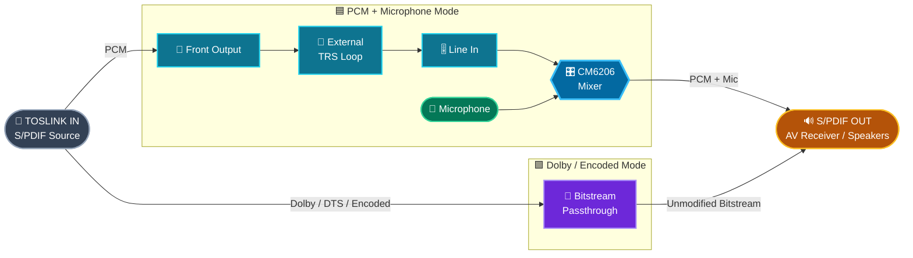

## Audio Signal Path

The CM6206 operates in two distinct modes:

- 🟦 **PCM Mode**: PCM audio is looped back through Line In and mixed with the microphone.
- 🟪 **Encoded Mode**: Dolby/encoded audio bypasses the mixer and is passed directly to S/PDIF Out.



### Signal Summary

| Mode | Input | Processing | Microphone | Output |
|---|---|---|---|---|
| 🟦 `pcm` | PCM S/PDIF | Front Out → TRS Loop → Line In → Mixer | ✅ Mixed | PCM S/PDIF |
| 🟪 `encoded` | Dolby / DTS / Encoded S/PDIF | Direct bitstream passthrough | ❌ Bypassed | Original encoded S/PDIF |

### PCM Mode

```text
TOSLINK IN
    │
    ▼
Front Output ──► External TRS Loop ──► Line In
                                          │
Microphone ───────────────────────────────┤
                                          ▼
                                     CM6206 Mixer
                                          │
                                          ▼
                                     S/PDIF OUT
```

PCM mode allows the CM6206 to combine the incoming PCM audio with the microphone before sending the resulting PCM stream to the S/PDIF output.

### Encoded Mode

```text
TOSLINK IN ──► Encoded Bitstream Passthrough ──► S/PDIF OUT
                       ▲
                       │
             Mixer and Mic bypassed
```

Encoded mode avoids processing the incoming bitstream. This allows formats such as Dolby Digital to reach the downstream decoder without being altered by the PCM mixing path.

> **Why the external TRS loop?**  
> In PCM mode, the CM6206's Front Output is physically looped back into Line In. This makes the incoming PCM audio available to the CM6206 mixer alongside the microphone input.
